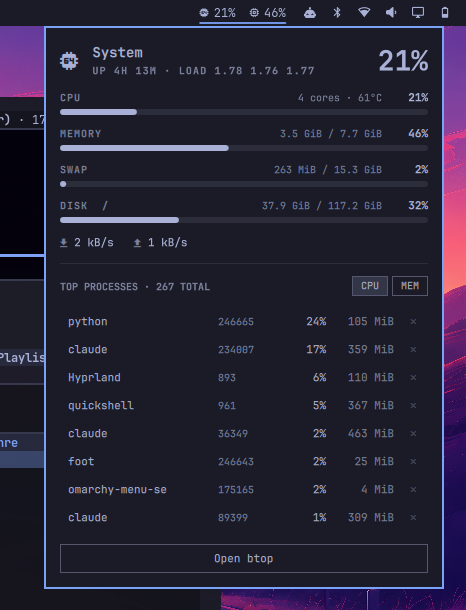

# omarchy-sysload

A tiny btop in your [Omarchy](https://omarchy.org) bar.

`sysload` is a third-party widget for the Omarchy shell. It puts a small
CPU / memory pill into the status bar and, on click, drops down a compact
panel with the figures that matter: CPU, memory, swap, disk, temperature,
load, network throughput and the top processes, each with a one-click
"end process" button. For everything else there is a button that opens the
real btop.



## Features

- **Bar pill** showing CPU and memory percent, e.g. `󰻠 23%  󰍛 41%`.
  Turns into your theme's urgent colour when either passes a threshold.
- **Detail panel** with meters for CPU (cores, temperature), memory, swap
  (hidden when you have none) and the root filesystem, plus uptime, load
  average and live download / upload rates.
- **Top processes** sorted by CPU or memory, with PID, CPU percent and
  resident memory. The `✕` on each row sends `SIGTERM`.
- **Keyboard driven**, like the stock Omarchy panels: `j`/`k` or arrows to
  move, `Delete` to end the selected process, `Enter` to open btop, `Esc`
  to close, `Tab` to hop to the neighbouring bar panel.
- **Cheap.** A small Python script reads `/proc` every few seconds. No
  daemons, no polling of external tools, no root.
- **Themed.** Colours, font and spacing come from the shell, so it follows
  every Omarchy theme automatically.

## Requirements

- Omarchy 4.x with the Quickshell based shell (`omarchy-shell`).
- Python 3 (already present on every Omarchy install).
- A Nerd Font in the bar (Omarchy's default) for the glyphs.
- `btop` for the "Open btop" button (installed by default on Omarchy).

## Install

```bash
omarchy plugin add https://github.com/ibornholz/omarchy-sysload.git --enable
```

Omarchy will warn you that plugins run unsandboxed inside the shell, show
you where it clones to, and ask for confirmation. The widget lands in the
right section of the bar. To put it somewhere specific:

```bash
omarchy bar move ibornholz.sysload --after omarchy.tray
# or
omarchy bar move ibornholz.sysload --section center --index 0
```

Updating and removing work like any other Omarchy plugin:

```bash
omarchy plugin update ibornholz.sysload
omarchy plugin disable ibornholz.sysload
omarchy plugin remove ibornholz.sysload
```

### Manual install

```bash
git clone https://github.com/ibornholz/omarchy-sysload.git \
  ~/.config/omarchy/plugins/ibornholz.sysload
omarchy-shell shell rescanPlugins
omarchy plugin enable ibornholz.sysload --after omarchy.tray
```

## Usage

| Action                      | Mouse                        | Keyboard (panel open)  |
|-----------------------------|------------------------------|------------------------|
| Open / close the panel      | Left click on the pill       | `Esc` closes           |
| Open btop                   | Right click on the pill, or the "Open btop" button | `Enter` |
| Refresh now                 | Middle click on the pill     |                        |
| Move process selection      | Hover a row                  | `j` / `k`, `↑` / `↓`   |
| Sort processes              | `CPU` / `MEM` buttons        | `h` / `l`, `←` / `→`   |
| End the selected process    | `✕` on the row               | `Delete`               |
| Switch to neighbouring panel|                              | `Tab` / `Shift+Tab`    |

The panel can also be driven over the shell's IPC, which is handy for a
keybinding:

```bash
omarchy-shell ibornholz.sysload toggle    # also: open, close, show, hide
```

## Settings

Settings live inline on the widget's entry in `~/.config/omarchy/shell.json`,
like every Omarchy bar widget. Set them with `omarchy bar set` or edit the
file; the shell reloads it on save.

| Key          | Default | Meaning                                              |
|--------------|---------|------------------------------------------------------|
| `interval`   | `3`     | Seconds between samples. The panel samples every 2 s while open. |
| `showMemory` | `true`  | Show the memory percent next to CPU in the bar pill. |
| `warnAt`     | `85`    | Percent at which the pill and meters switch to the urgent colour. |

```bash
omarchy bar set ibornholz.sysload interval 5
omarchy bar set ibornholz.sysload showMemory false --json
omarchy bar set ibornholz.sysload warnAt 90
```

## How it works

```
BarWidget.qml   the pill in the bar; loads Panel.qml and forwards open/close
Panel.qml       the popup (KeyboardPanel) and the sampling timer
sysload-stats   Python: reads /proc and prints one JSON object
manifest.json   Omarchy plugin manifest
```

`Panel.qml` runs `sysload-stats` on a timer and parses its JSON. The script
keeps the previous CPU, per-process and network counters in
`$XDG_RUNTIME_DIR/omarchy-sysload.json`, so every run reports usage over
the interval since the last run instead of a lifetime average. The first
run after a reboot takes two samples 300 ms apart.

Per-process CPU is scaled like `top`: a process saturating one core shows
100 %. Temperature comes from the first of `coretemp`, `k10temp`,
`zenpower` or `cpu_thermal` found under `/sys/class/hwmon`, falling back
to the `x86_pkg_temp` thermal zone.

Killing a process runs `kill -TERM <pid>` as your user. Processes you do
not own simply ignore it.

## Development

Files under `~/.config/omarchy/plugins/` hot-reload on save. Errors show
up in the shell log:

```bash
journalctl --user -f | grep -iE "sysload|qml"
```

The widget follows the structure of Omarchy's own popup widgets in
`/usr/share/omarchy/shell/plugins/panels/`, which are the best reference
for the available UI components (`KeyboardPanel`, `PanelKeyCatcher`,
`PanelActionButton`, `Button`, `PanelSeparator`, ...).

Validate the manifest before committing:

```bash
omarchy plugin validate .
```

## License

MIT, see [LICENSE](LICENSE).
